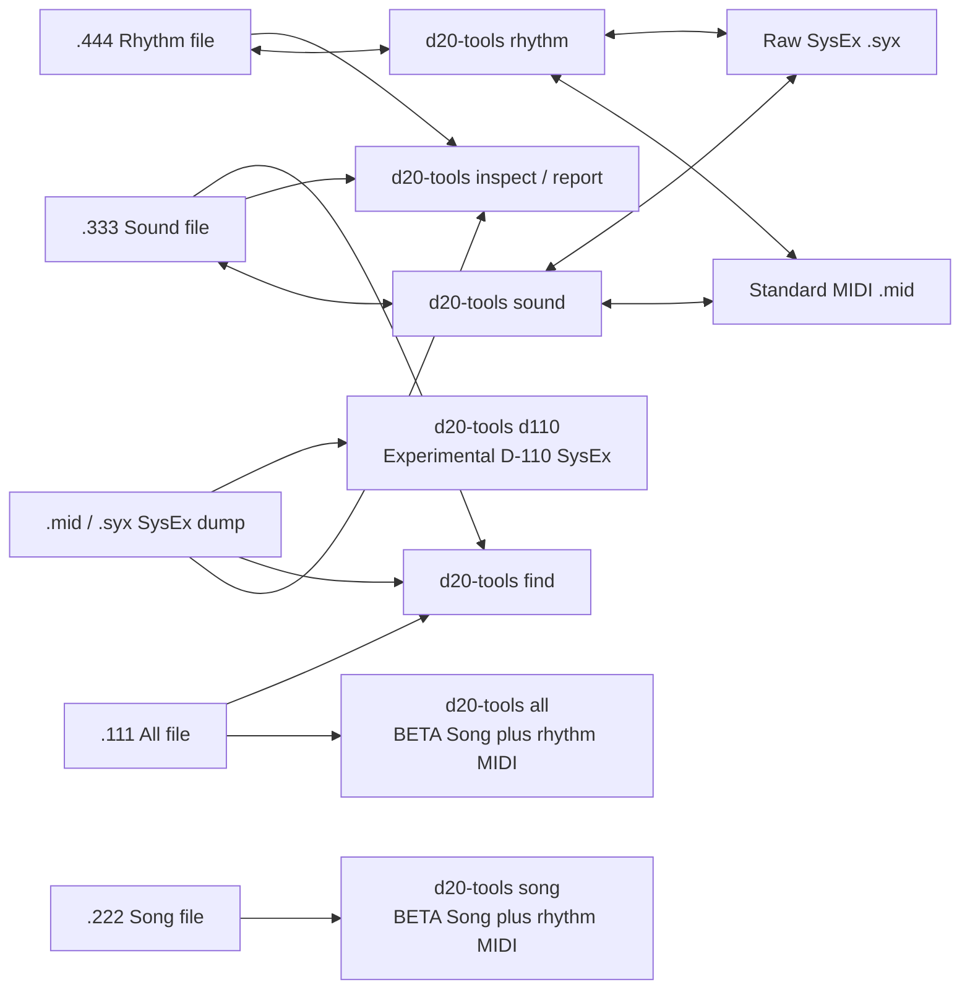

# Roland D-20 Tools

## Origins and thanks

This project grew out of a [VCFed forum discussion about decoding the
mysterious Roland D-20 floppy format](https://forum.vcfed.org/index.php?threads/roland-d-20-decoding-the-mysterious-floppy-format.1243226/).

Special thanks to [David Given](https://github.com/davidgiven) and
[FluxEngine](https://github.com/davidgiven/fluxengine), which makes it possible
to read and write data on D-20 floppy disks.

And a heartfelt thanks and eternal gratitude to
[trondl909](https://github.com/trondl909) for keeping the project alive when
it felt like I might be the only person in the world who still cared about the
mysterious ways of the D-20.

## D20 Tools overview

Safe, local inspection and conversion tools for Roland D-20 SysEx and disk
files. Nothing is uploaded: the tools read and write files on your computer.

Version 0.2 provides detailed, read-only reports for D-20 System, Patch,
Timbre, Tone, and Rhythm data; file identification; named-sound search; and
Sound/Rhythm conversion. It accepts standard MIDI, raw SysEx, and the native
D-20 file types described below. `inspect` also identifies native Song (`.222`)
and All (`.111`) containers by their contents. BETA Song/All note export and
individual stored rhythm-pattern note export are available. SONG and ALL now
expand saved pattern selections into a separate rhythm MIDI track; `.444` can
export one, all, or its saved selection track. SONG and ALL read their saved
tempo by default. Factory preset notes can be read from an owned tone ROM
using `--factory-rom`; see the Rhythm guide for the supported image.

## Install

Python 3.10 or newer is required.

```sh
python3 -m venv .venv
source .venv/bin/activate
python -m pip install --upgrade pip
python -m pip install .
```

For development or release checks, install the optional tools and run:

```sh
python -m pip install -e ".[dev]"
make check
make coverage
make package
```

## Quick start

```sh
d20-tools --version
d20-tools inspect D20BACKUP.mid
d20-tools report patch D20BACKUP.mid --patch 1 --showtones
d20-tools find ~/D20-library "Star Synth"
d20-tools sound TESTSND.333 TESTSND.mid
d20-tools rhythm TESTRHY.444 TESTRHY.syx
d20-tools rhythm TESTRHY.444 track.mid --notes track --tempo-bpm 120
d20-tools rhythm TESTRHY.444 patterns.mid --notes all --tempo-bpm 120
d20-tools pattern TESTRHY.444 pattern.mid --pattern-id 0x3f --tempo-bpm 120
d20-tools song MYSONG.222 MYSONG-notes.mid
d20-tools all MYBACKUP.111 MYBACKUP-notes.mid
d20-tools d110 D20BACKUP.mid D110-SNDRHY.syx --report D110-SNDRHY.md
```

Run `d20-tools <command> --help` for every option and an example. The
experimental `d110` command writes its full validation table to `--report` and
keeps terminal output concise. Reports can be Markdown (the default), HTML,
JSON, or CSV.

Existing output files are protected. Add `--force` only when you intend to
replace the destination.

| Command | Status | Documentation |
| --- | --- | --- |
| `d20-tools report` | Ready — detailed System, Patch, Timbre, Tone, and Rhythm reports | [Diagnostic reports](docs/reports.md) |
| `d20-tools inspect` | Ready — compact DT1 area summary or structured Markdown/HTML inventory | [SysEx inspector](docs/sysex-inspector.md) |
| `d20-tools find` | Ready — recursive named-sound search | [Sound finder](docs/sound-finder.md) |
| `d20-tools doctor` | Ready — installed-version and capability summary | [Doctor](docs/doctor.md) |
| `d20-tools sound` | Ready | [Sound converter](docs/sound-converter.md) |
| `d20-tools rhythm` | Ready for SysEx; **BETA** for pattern/track note MIDI | [Rhythm converter](docs/rhythm-converter.md) |
| `d20-tools pattern` | **BETA** — one pattern's note events, with `--factory-rom` for presets | [Pattern note export](docs/rhythm-converter.md#one-stored-pattern-as-notes-beta) |
| `d20-tools d110` | **Experimental** — one-way D-20 to D-110 conversion; verify the report before use | [D-110 experimental converter](docs/d110-experimental.md) |
| `d20-tools song` | **BETA** — one-way native Song note export | [Song note export](docs/song-wip.md) |
| `d20-tools all` | **BETA** — one-way native All note export | [All-file note export](docs/all-wip.md) |

## Design



See [the architecture guide](docs/architecture.md) for the module-level map and
the [memory-address reference](docs/memory-map.md) for the source-derived D-20
address and native-file layout tables.
The [firmware reverse-mapping guide](docs/firmware-reverse-mapping.md) records
the Ghidra workflow, ROM function addresses, and evidence behind the MIDI export.
The [factory pattern guide](docs/factory-rhythm-rom-mapping.md) covers preset
selection, tone-ROM pointers, and reproduction of the factory note extraction.

## How to choose a command

Start with `inspect` when you do not know what a file contains. It is
read-only, validates recognised data, identifies the file type, and gives a
short area summary. Use `report` when you want the values stored in a specific
memory area. Both commands leave the source file unchanged.

`report` reads a dump or native file and turns a selected memory location into
a parameter report:

| Report | What it shows | Example |
| --- | --- | --- |
| `system` | Global D-20 settings | `d20-tools report system D20BACKUP.mid` |
| `patch` | A list of populated Patches, or one Patch and its two assigned Tones | `d20-tools report patch D20BACKUP.mid --patch 1 --showtones` |
| `timbre` | A list of populated Timbres, or one user Timbre and its assigned Tone | `d20-tools report timbre TESTSND.333 --timbre A-11 --showtones` |
| `tone` | A list of internal user Tones, or one Tone including PCM waveform names | `d20-tools report tone D20BACKUP.syx --tone i01` |
| `rhythm` | Rhythm Setup parameters | `d20-tools report rhythm TESTRHY.444` |

`--showtones` on a selected Patch or Timbre follows its assigned internal/user
Tone or Tones and appends their reports. The [diagnostic report
guide](docs/reports.md) has all options, identifiers, and sample output.

Omit `--patch`, `--timbre`, or `--tone` to list every complete, populated
record of that type in the input. Add the option only when you want the full
parameter report for one selected record.

### Identify a dump or disk file

Use `inspect` for a compact terminal summary, or add `--report FILE` for a
complete Markdown, HTML, JSON, or CSV inventory. It labels a complete MIDI or
SysEx backup `ALL (MIDI DUMP)` and a native `.111` container `ALL (DISK)`.
Native Song and All inputs include their embedded Rhythm or Sound/Rhythm area
summary. See [the SysEx inspector guide](docs/sysex-inspector.md) for exact
coverage and limitations.

```sh
d20-tools inspect ~/D20-library/D20BACKUP.mid
d20-tools inspect ~/D20-library/TESTSND.333
```

### Find a sound by name in a library

`find` searches a folder and all its subfolders for Patch, Timbre, and Tone
names. It accepts MIDI, SysEx, Sound, and All files, then tells you which file
and memory location holds each match. Use JSON or CSV when feeding the results
to another tool.

```sh
d20-tools find ~/D20-library "Star Synth"
d20-tools find ~/D20-library StarSynth --type tone --format json
d20-tools find ~/D20-library "Piano" --type patch --exact --format csv
```

### Convert native Sound and Rhythm files

`sound` converts a `.333` Sound disk file to a Standard MIDI (`.mid`) or raw
SysEx (`.syx`) dump, and converts either dump form back to `.333`. `rhythm`
does the equivalent job for `.444` Rhythm files. Source and destination names
are explicit; an existing destination is protected unless you add `--force`.

```sh
d20-tools sound TESTSND.333 TESTSND.mid
d20-tools sound TESTSND.mid TESTSND-copy.333
d20-tools rhythm TESTRHY.444 TESTRHY.syx
d20-tools rhythm TESTRHY.syx TESTRHY-copy.444
```

### Check the installation

`doctor` reports the installed version, Python and MIDI-library versions,
supported file types, and which functions are complete or still in progress.

```sh
d20-tools doctor
d20-tools --version
```

`song` and `all` export discrete Song note events and expand the saved rhythm
selection list into a separate drum MIDI track. They read the saved tempo
from the file by default. Use `--tempo-bpm` to override it for audition.
The BETA output includes candidate meter changes and stored rhythm-pattern
hits. Add `--factory-rom` for arrangements using factory presets. Original
patches and channel routing remain unresolved. Export one stored pattern separately with `d20-tools pattern`.
Source files are never modified. See the [Song](docs/song-wip.md), [All](docs/all-wip.md), and
[pattern](docs/rhythm-converter.md#one-stored-pattern-as-notes-beta) guides.

## Testing

```sh
python -m unittest discover -s tests -v
```

The public tests use generated fixtures. Optional local regression tests use
your own D-20 files without copying them into the repository:

```sh
D20_DEMO_DUMP_MID=/path/to/DemoDump.mid \
D20_TESTSND_333=/path/to/TESTSND.333 \
D20_TESTRHY_444=/path/to/TESTRHY.444 \
D20_FACTORY_MID=/path/to/D1020ORIG.MID \
D20_TESTSONG_222=/path/to/song.222 \
D20_TESTALL_111=/path/to/backup.111 \
python -m unittest discover -s tests -v
```

## Status and compatibility

This is an independent utility for archival and conversion. Always keep an
untouched copy of an original disk file. The `.333` and `.444` converters
validate their D-20 container layouts and Roland DT1 checksums before writing.

## Bonus: Roland D-20 PCM samples

[Download the PCM sample ZIP](https://github.com/rjburrows/roland-d20-tools/raw/refs/heads/main/bonus/D20_PCM_Samples.zip) — 256 named WAV selections in two banks, extracted from the supplied D-20 PCM ROM images using the tone ROM's selection metadata. These are raw factory waveform regions, not complete synthesizer patches. Names follow the D-20 Owner's Manual PCM tables.

**Original PCM waveform content copyright Roland Corporation. Shared for experimentation and non-commercial use only.** The samples are excluded from this project's MIT licence; no licence or endorsement from Roland is claimed.

See the [Bonus sample guide](bonus/README.md) for the source ROM filenames, extraction details, playback limitations and copyright notice.

## License

Project software is MIT licensed. See [LICENSE](LICENSE). The Roland PCM sample content is excluded; see its separate [copyright and usage notice](bonus/NOTICE.txt).

## Releases and security

See [the changelog](CHANGELOG.md) for version history, [the contribution and
release guide](docs/contributing.md) for local and CI checks, and
[SECURITY.md](SECURITY.md) for responsible vulnerability reporting.

### Backup safety and native-byte preservation

Conflicting DT1 writes and mixed device IDs are rejected; identical repeated
blocks are accepted and count only once toward memory coverage. Reports cannot
overwrite inputs or another output, even with `--force` or filesystem aliases.
An ALL dump classification requires full coverage of every expected area.
Unknown areas are not reported as complete.

Exporting a native Sound/Rhythm file now also writes `<output>.native.json`.
Keep this preservation sidecar with the MIDI/SysEx export: it stores the original
native bytes, including opaque header/reserved regions, and the export's SHA-256.
Converting that unchanged export back restores the original file byte for byte,
including its stored name, even if the destination filename differs. The sidecar
is never sent to hardware. Both output paths are checked before writing.

If the export changes, restoration fails explicitly rather than applying stale
native data. Keep the original pair; move the sidecar aside to request a normalized
conversion of an edited export. Without a sidecar, the tool reports that native
headers/reserved bytes are regenerated and unrelated SysEx areas are omitted.
Individual files are written atomically; a multi-file export is not a filesystem
transaction, so retain the original backup if an I/O error interrupts it.
