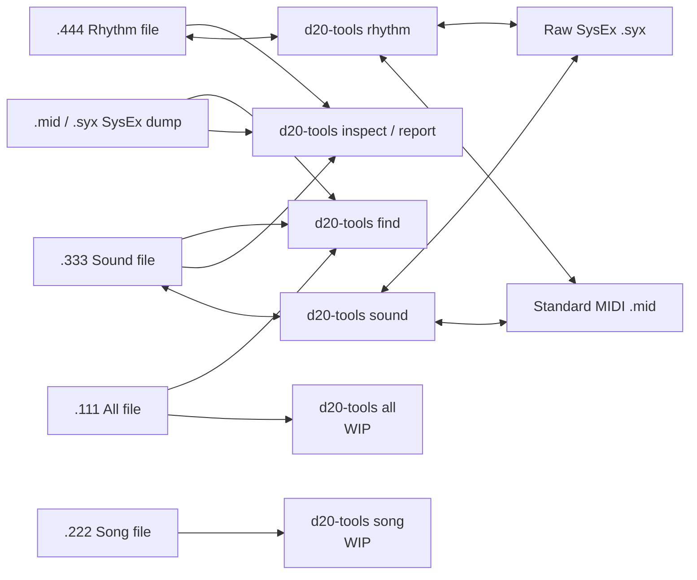

# Roland D-20 Tools

## Origins and thanks

This project grew out of a [VCFed forum discussion about decoding the
mysterious Roland D-20 floppy format](https://forum.vcfed.org/index.php?threads/roland-d-20-decoding-the-mysterious-floppy-format.1243226/).

Special thanks to [David Given](https://github.com/davidgiven) and
[FluxEngine](https://github.com/davidgiven/fluxengine), which makes it possible
to read and write data on D-20 floppy disks.

And a heartfelt thanks and eternal gratitude to
[Trond Larsen](https://github.com/trondl909) for keeping the project alive when
it felt like I might be the only person in the world who still cared about the
mysterious ways of the D-20.

## D20 Tools overview

Safe, local inspection and conversion tools for Roland D-20 SysEx and disk
files. Nothing is uploaded: the tools read and write files on your computer.

Version 0.1 centres on `report`: detailed, read-only decoding of the System,
Patch, Timbre, Tone, and Rhythm settings stored in standard MIDI, Raw SysEx,
Sound (`.333`), and Rhythm (`.444`) D-20 files. It also provides file
identification, named-sound search, and Sound/Rhythm conversion. `inspect`
identifies native Song (`.222`) and All (`.111`) containers from their contents.
The Song and All conversion commands remain work-in-progress placeholders; they
do not modify or convert files yet.

## Install

Python 3.10 or newer is required.

```sh
python3 -m venv .venv
source .venv/bin/activate
python -m pip install --upgrade pip
python -m pip install .
```

For development or release checks, install the optional tools and run:

```sh
python -m pip install -e ".[dev]"
make check
make coverage
make package
```

## Commands

```sh
d20-tools --version
d20-tools report patch TESTSND.333
d20-tools report timbre TESTSND.333
d20-tools report tone TESTSND.333
d20-tools report patch D20BACKUP.mid --patch 1
d20-tools report patch TESTSND.333 --patch 1 --showtones
d20-tools report timbre TESTSND.333 --timbre A-11 --showtones
d20-tools report tone D20BACKUP.syx --tone i01
d20-tools inspect D20BACKUP.mid
d20-tools inspect TESTSND.333
d20-tools find ~/D20-library "Star Synth"
d20-tools find ~/D20-library StarSynth --type tone --format json
d20-tools doctor
d20-tools sound TESTSND.333 TESTSND.mid
d20-tools sound TESTSND.mid TESTSND.333
d20-tools rhythm TESTRHY.444 TESTRHY.syx
d20-tools rhythm TESTRHY.syx TESTRHY.444
```

Existing output files are protected. Add `--force` only when you intend to
replace the destination.

| Command | Status | Documentation |
| --- | --- | --- |
| `d20-tools report` | Ready — detailed System, Patch, Timbre, Tone, and Rhythm reports | [Diagnostic reports](docs/reports.md) |
| `d20-tools inspect` | Ready — compact DT1 area summary | [SysEx inspector](docs/sysex-inspector.md) |
| `d20-tools find` | Ready — recursive named-sound search | [Sound finder](docs/sound-finder.md) |
| `d20-tools doctor` | Ready — installed-version and capability summary | [Doctor](docs/doctor.md) |
| `d20-tools sound` | Ready | [Sound converter](docs/sound-converter.md) |
| `d20-tools rhythm` | Ready | [Rhythm converter](docs/rhythm-converter.md) |
| `d20-tools song` | WIP placeholder | [Song WIP](docs/song-wip.md) |
| `d20-tools all` | WIP placeholder | [All-file WIP](docs/all-wip.md) |

## Design



See [the architecture guide](docs/architecture.md) for the module-level map and
the [memory-address reference](docs/memory-map.md) for the source-derived D-20
address and native-file layout tables.

## Inspection scope

`d20-tools inspect` is deliberately brief: it validates a `.333`, `.444`,
`.mid`, `.midi`, or `.syx` file and prints the number of valid DT1-equivalent
messages in each recognised area. It also identifies native `.222` Song and
`.111` All containers from their structure rather than their filename
extension. Every inspection ends with an explicit file-type declaration. It
writes no file. Inspection labels a complete MIDI/SysEx backup as `ALL (MIDI
DUMP)` and a native `.111` container as `ALL (DISK)`. Native Song and All
inputs also expand their embedded Rhythm or Sound/Rhythm data into the same
concise area summary. Detailed parameter reports are available through the
nested `d20-tools report` commands for System, Patch, Timbre, Tone, and Rhythm
Setup data. All inspection and report commands are read-only.

## Start with `report`

`report` is the main D-20 analysis tool. It reads a dump or native file and
turns a selected memory location into a clear parameter report; it never writes
to the source file. Use the report that answers the question you have:

| Report | What it shows | Example |
| --- | --- | --- |
| `system` | Global D-20 settings | `d20-tools report system D20BACKUP.mid` |
| `patch` | A list of populated Patches, or one Patch and its two assigned Tones | `d20-tools report patch D20BACKUP.mid --patch 1 --showtones` |
| `timbre` | A list of populated Timbres, or one user Timbre and its assigned Tone | `d20-tools report timbre TESTSND.333 --timbre A-11 --showtones` |
| `tone` | A list of internal user Tones, or one Tone including PCM waveform names | `d20-tools report tone D20BACKUP.syx --tone i01` |
| `rhythm` | Rhythm Setup parameters | `d20-tools report rhythm TESTRHY.444` |

`--showtones` is available for Patch and Timbre reports. It automatically
follows the assigned internal user Tone or Tones and appends their reports, so
you can understand a complete sound configuration in one command. Full
parameters, valid identifiers, and example output are in the
[diagnostic report guide](docs/reports.md).

Omit `--patch`, `--timbre`, or `--tone` to list every complete, populated
record of that type in the input. Add the option only when you want the full
parameter report for one selected record.

## Choosing the right tool

After identifying a file with `inspect`, use the command that matches what you
want to do. Every command has built-in help with at least one example:

```sh
d20-tools <command> --help
```

### Identify a dump or disk file

`inspect` is the quick companion to `report`. It recognises D-20 SysEx areas
and native containers, counts the valid messages it finds, and tells you
whether the input is a Sound, Rhythm, Song, or All file. It does not alter the
file. Run it when you are unsure what an input contains, then use `report` to
decode the area you care about.

```sh
d20-tools inspect ~/D20-library/D20BACKUP.mid
d20-tools inspect ~/D20-library/TESTSND.333
```

### Find a sound by name in a library

`find` searches a folder and all its subfolders for Patch, Timbre, and Tone
names. It accepts MIDI, SysEx, Sound, and All files, then tells you which file
and memory location holds each match. Use JSON or CSV when feeding the results
to another tool.

```sh
d20-tools find ~/D20-library "Star Synth"
d20-tools find ~/D20-library StarSynth --type tone --format json
d20-tools find ~/D20-library "Piano" --type patch --exact --format csv
```

### Convert native Sound and Rhythm files

`sound` converts a `.333` Sound disk file to a Standard MIDI (`.mid`) or raw
SysEx (`.syx`) dump, and converts either dump form back to `.333`. `rhythm`
does the equivalent job for `.444` Rhythm files. Source and destination names
are explicit; an existing destination is protected unless you add `--force`.

```sh
d20-tools sound TESTSND.333 TESTSND.mid
d20-tools sound TESTSND.mid TESTSND-copy.333
d20-tools rhythm TESTRHY.444 TESTRHY.syx
d20-tools rhythm TESTRHY.syx TESTRHY-copy.444
```

### Check the installation

`doctor` reports the installed version, Python and MIDI-library versions,
supported file types, and which functions are complete or still in progress.

```sh
d20-tools doctor
d20-tools --version
```

`song` and `all` are visible placeholders for future file conversion work.
They are clearly marked WIP and do not modify files. You can already inspect
native `.222` Song and `.111` All files, and search an All file with `find`.

## Testing

```sh
python -m unittest discover -s tests -v
```

The public tests use generated fixtures. Optional local regression tests use
your own D-20 files without copying them into the repository:

```sh
D20_DEMO_DUMP_MID=/path/to/DemoDump.mid \
D20_TESTSND_333=/path/to/TESTSND.333 \
D20_TESTRHY_444=/path/to/TESTRHY.444 \
D20_FACTORY_MID=/path/to/D1020ORIG.MID \
python -m unittest discover -s tests -v
```

## Status and compatibility

This is an independent utility for archival and conversion. Always keep an
untouched copy of an original disk file. The `.333` and `.444` converters
validate their D-20 container layouts and Roland DT1 checksums before writing.

## License

MIT. See [LICENSE](LICENSE).

## Releases and security

See [the changelog](CHANGELOG.md) for version history, [the contribution and
release guide](docs/contributing.md) for local and CI checks, and
[SECURITY.md](SECURITY.md) for responsible vulnerability reporting.
