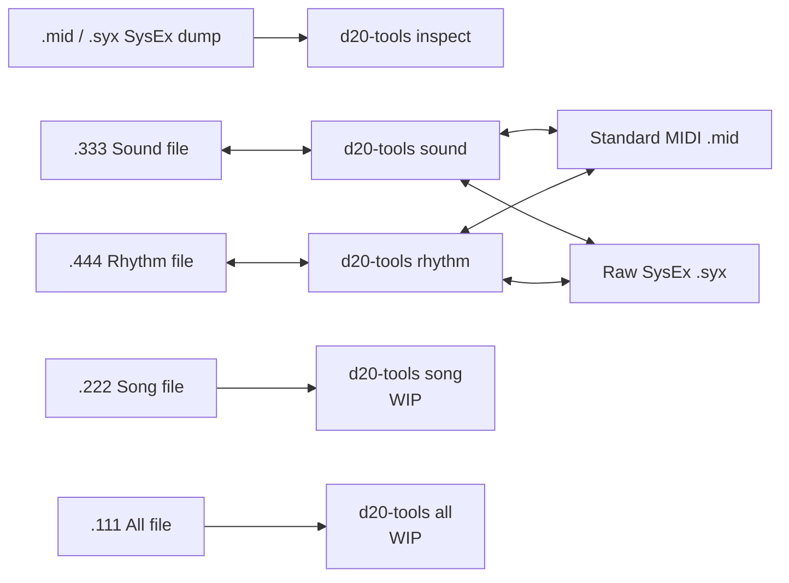

# Roland D-20 Tools

Safe, local inspection and conversion tools for Roland D-20 SysEx and disk
files. Nothing is uploaded: the tools read and write files on your computer.

Version 0.1 inspects standard MIDI/Raw SysEx D-20 dumps and converts Sound
(`.333`) and Rhythm (`.444`) disk files. Song
(`.222`) and All (`.111`) commands are deliberately present as work-in-progress
placeholders; they do not modify or convert files yet.

## Install

Python 3.10 or newer is required.

```sh
python3 -m venv .venv
source .venv/bin/activate
python -m pip install --upgrade pip
python -m pip install .
```

## Commands

```sh
d20-tools inspect D20BACKUP.mid
d20-tools sound TESTSND.333 TESTSND.mid
d20-tools sound TESTSND.mid TESTSND.333 --name TESTSND
d20-tools rhythm TESTRHY.444 TESTRHY.syx
d20-tools rhythm TESTRHY.syx TESTRHY.444 --name TESTRHY
```

Existing output files are protected. Add `--force` only when you intend to
replace the destination.

| Command | Status | Documentation |
| --- | --- | --- |
| `d20-tools inspect` | Ready | [SysEx inspector](docs/sysex-inspector.md) |
| `d20-tools sound` | Ready | [Sound converter](docs/sound-converter.md) |
| `d20-tools rhythm` | Ready | [Rhythm converter](docs/rhythm-converter.md) |
| `d20-tools song` | WIP placeholder | [Song WIP](docs/song-wip.md) |
| `d20-tools all` | WIP placeholder | [All-file WIP](docs/all-wip.md) |

## Design



See [the architecture guide](docs/architecture.md) for the module-level map.

## Testing

```sh
python -m unittest discover -s tests -v
```

The public tests use generated fixtures. Optional local regression tests use
your own `Awkward.mid` and `TESTSND.333` without copying either file into the
repository:

```sh
D20_AWKWARD_MID=/path/to/Awkward.mid \
D20_TESTSND_333=/path/to/TESTSND.333 \
python -m unittest discover -s tests -v
```

## Status and compatibility

This is an independent utility for archival and conversion. Always keep an
untouched copy of an original disk file. The `.333` and `.444` converters
validate their D-20 container layouts and Roland DT1 checksums before writing.

## License

MIT. See [LICENSE](LICENSE).
