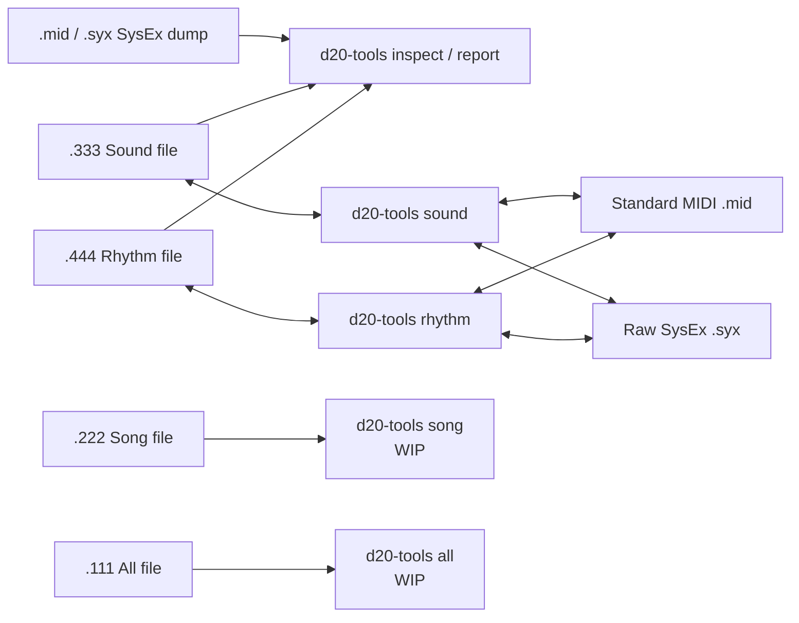

# Roland D-20 Tools

Safe, local inspection and conversion tools for Roland D-20 SysEx and disk
files. Nothing is uploaded: the tools read and write files on your computer.

Version 0.1 inspects and reports on standard MIDI, Raw SysEx, Sound (`.333`),
and Rhythm (`.444`) D-20 files, and converts Sound and Rhythm disk files. Song
(`.222`) and All (`.111`) commands are deliberately present as work-in-progress
placeholders; they do not modify or convert files yet.

## Install

Python 3.10 or newer is required.

```sh
python3 -m venv .venv
source .venv/bin/activate
python -m pip install --upgrade pip
python -m pip install .
```

## Commands

```sh
d20-tools inspect D20BACKUP.mid
d20-tools inspect TESTSND.333
d20-tools report patch D20BACKUP.mid --patch 1
d20-tools report patch TESTSND.333 --patch 1 --showtones
d20-tools report timbre TESTSND.333 --timbre A-11 --showtones
d20-tools report tone D20BACKUP.syx --tone i01
d20-tools sound TESTSND.333 TESTSND.mid
d20-tools sound TESTSND.mid TESTSND.333
d20-tools rhythm TESTRHY.444 TESTRHY.syx
d20-tools rhythm TESTRHY.syx TESTRHY.444
```

Existing output files are protected. Add `--force` only when you intend to
replace the destination.

| Command | Status | Documentation |
| --- | --- | --- |
| `d20-tools inspect` | Ready — compact DT1 area summary | [SysEx inspector](docs/sysex-inspector.md) |
| `d20-tools report` | Ready — detailed read-only diagnostic reports | [Diagnostic reports](docs/reports.md) |
| `d20-tools sound` | Ready | [Sound converter](docs/sound-converter.md) |
| `d20-tools rhythm` | Ready | [Rhythm converter](docs/rhythm-converter.md) |
| `d20-tools song` | WIP placeholder | [Song WIP](docs/song-wip.md) |
| `d20-tools all` | WIP placeholder | [All-file WIP](docs/all-wip.md) |

## Design



See [the architecture guide](docs/architecture.md) for the module-level map and
the [memory-address reference](docs/memory-map.md) for the source-derived D-20
address and native-file layout tables.

## Inspection scope

`d20-tools inspect` is deliberately brief: it validates a `.333`, `.444`,
`.mid`, `.midi`, or `.syx` file and prints the number of valid DT1-equivalent
messages in each recognised area. It writes no file. Detailed parameter reports
are available through the nested `d20-tools report` commands for System, Patch,
Timbre, Tone, and Rhythm Setup data. All inspection and report commands are
read-only.

## Testing

```sh
python -m unittest discover -s tests -v
```

The public tests use generated fixtures. Optional local regression tests use
your own D-20 files without copying them into the repository:

```sh
D20_DEMO_DUMP_MID=/path/to/DemoDump.mid \
D20_TESTSND_333=/path/to/TESTSND.333 \
D20_TESTRHY_444=/path/to/TESTRHY.444 \
D20_FACTORY_MID=/path/to/D1020ORIG.MID \
python -m unittest discover -s tests -v
```

## Status and compatibility

This is an independent utility for archival and conversion. Always keep an
untouched copy of an original disk file. The `.333` and `.444` converters
validate their D-20 container layouts and Roland DT1 checksums before writing.

## License

MIT. See [LICENSE](LICENSE).
