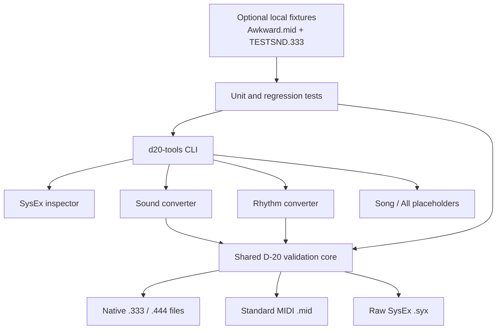

# Architecture

`core.py` owns file safety, DT1 checksum validation, address-aware assembly,
and atomic output replacement. `sound.py` and `rhythm.py` own only the rules
for their respective native containers. The CLI dispatches one explicit
subcommand and never guesses a file type.
