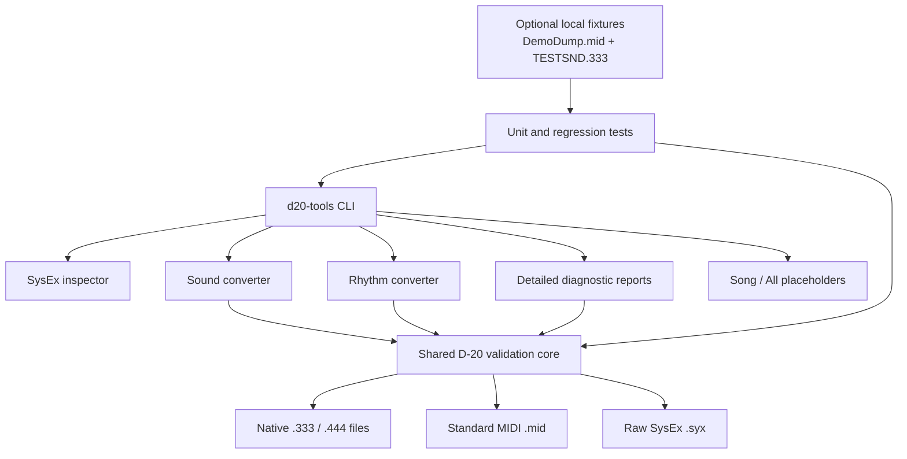

# Architecture

`core.py` owns file safety, DT1 checksum validation, address-aware assembly,
text and note helpers, and atomic output replacement. `sound.py` and
`rhythm.py` own only the rules for their respective native containers.
`reports.py` decodes complete records only; it never substitutes missing bytes.
The CLI dispatches one explicit subcommand and never guesses a file type. See
the [memory-address reference](memory-map.md) for the layouts used by each
module.
