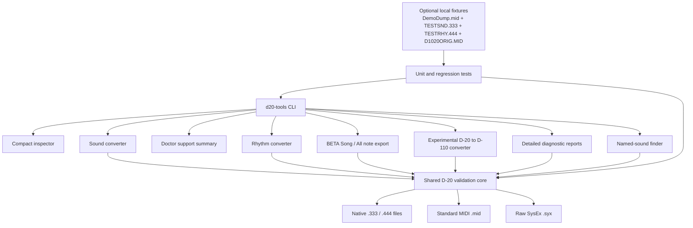

# Architecture

`core.py` owns file safety, DT1 checksum validation, address-aware assembly,
text and note helpers, atomic output replacement, and native-file adaptation
for the read-only inspector and reports. `sound.py` and `rhythm.py` own only
the rules for their respective native containers.
`reports.py` decodes complete records only; it never substitutes missing bytes.
`d110.py` produces only validated D-110 SysEx and comparison reports; it is
kept separate because D-110 hardware round-trip validation is still pending.
`song.py` decodes the shared Song region in native `.222` and `.111` files to
provisional note lanes. `pattern.py` validates stored pattern hit triples and
expands the saved selection list to an additional rhythm MIDI track for Song,
All, or Rhythm note export. Song/All tempo comes from the saved header or an
explicit override. ROM preset note records and
hardware note-off policy remain outside these BETA decoders.
The CLI dispatches one explicit subcommand and never guesses a file type. See
the [memory-address reference](memory-map.md) for the layouts used by each
module.
